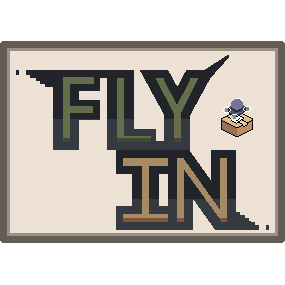
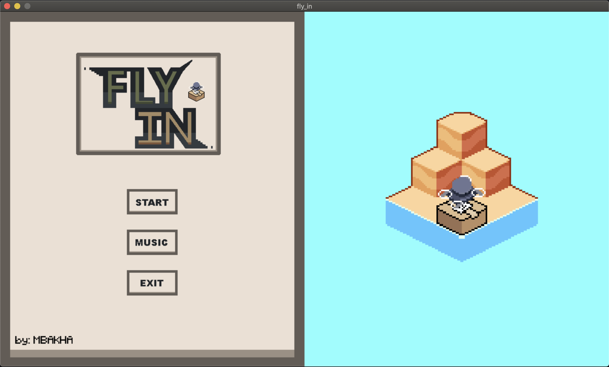
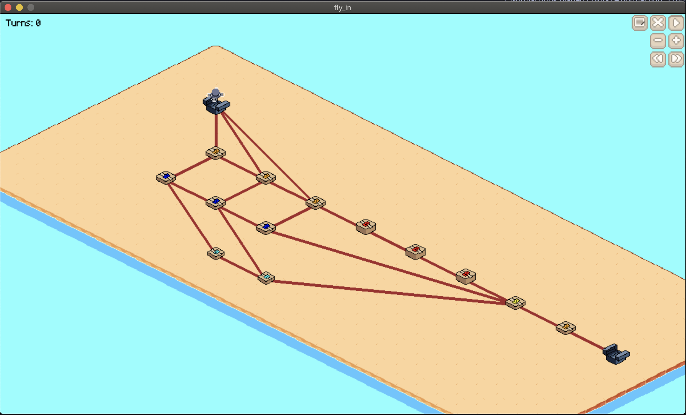
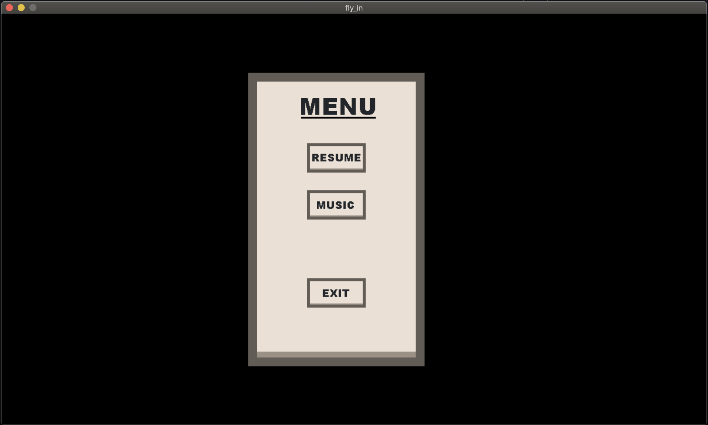
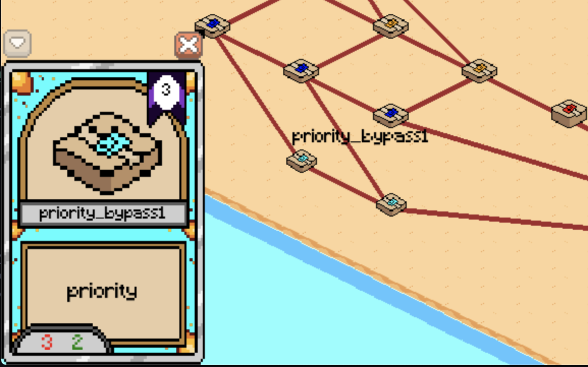
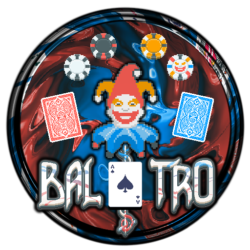

# *This project has been created as part of the 42 curriculum by Mbakha.*


<div align="center">

　　


### *An interactive drone traffic management and pathfinding visualization system*

</div>

<br>

<div align="center">

## Table of Contents

<br>

<div align="left">

- [Description](#description)
- [Features](#features)
- [Instructions](#instructions)
- [Algorithm & Implementation Strategy](#algorithm--implementation-strategy)
- [Visual Representation & User Experience](#visual-representation--user-experience)
- [Configuration File Format](#configuration-file-format)
- [Resources](#resources)
- [Project Structure](#project-structure)

<br>

<div align="center">

## Description


<div align="left">

<br>

**fly-in** is an interactive drone traffic management and pathfinding visualization system. The project simulates complex logistics scenarios where multiple drones must navigate through interconnected hubs (nodes) with capacity constraints, restricted zones, and priority pathways. It combines graph-based pathfinding algorithms with real-time visualization to demonstrate efficient resource allocation and congestion management in constrained environments.

The core goal is to route drones from a start hub to a goal hub while respecting:
- **Hub capacity limits**: Maximum number of drones that can occupy each hub simultaneously
- **Link capacity limits**: Maximum number of drones that can traverse connections between hubs
- **Zone restrictions**: Special zones (normal, blocked, restricted, priority) with different traversal costs

---

<div align="center">

## Features


<div align="left">

<br>

- **Visual Network Simulation**: Real-time pygame-based visualization of drone movement through a multi-hub network
- **Intelligent Pathfinding**: Dijkstra pathfinding with dynamic cost adjustments based on zone types and congestion
- **Configuration-Driven Scenarios**: Define custom hub layout, drones numbers and connection between hubs
- **Capacity Management**: Track and enforce capacity limits on both hubs and connections
- **Zone-Based Routing**: Support for multiple zone types (normal, restricted, priority, blocked) with different traversal penalties
- **Interactive UI**: Menu system with music controls, start/exit buttons, and hub information cards

---

<div align="center">

## Instructions


<div align="left">

<br>

### Compilation & Installation

1. **Install dependencies**:
   ```bash
   make install
   ```
   This installs the required packages from `requirements.txt`:
   - `pygame-ce` - Community Edition of Pygame for rendering and events
   - `webcolors` - color name to RGB conversion
   - `pydantic` - Data validation and modeling
   - `flake8` - Code linting
   - `mypy` - Static type checking

### Running the Application

Execute the program with a configuration file:

```bash
make run
```

Or run directly:

```bash
python3 Script/Fly_in.py config.txt
```

To use a custom config:

```bash
python3 Script/Fly_in.py your_config_file.txt
```

### Debugging

For interactive debugging with the Python debugger:

```bash
make debug
```

### Verify:

verify flake8 and mypy

   ```bash
   make lint
   ```

### Cleaning

Remove cache files and compiled bytecode:

```bash
make clean
```

---

<div align="center">

## Algorithm & Implementation Strategy

<br>
<div align="left">

### Pathfinding Algorithm

The project employs a **Dijkstra pathfinding** algorithm with zone-aware cost functions:


1. **Cost Calculation Per Zone**:
   - `normal` zone: 2 costs (baseline cost)
   - `restricted` zone: 4 costs (high penalty for narrow passages)
   - `priority` zone: 1.5 costs (low cost for fast lanes)
   - `blocked` zone: skipped entirely (impassable)

2. **Congestion-Aware Routing**:
   - If a hub or connection is at capacity, additional cost `+2` is applied
   - Drones recalculate paths when blocked, avoiding jams dynamically
   - The algorithm maintains visited nodes and updates path costs if a better route is found

3. **Path Reconstruction**:
   - Each hub stores a `path` reference to its predecessor
   - Starting from the goal, backtrack through predecessors to build the optimal route
   - Drones follow this pre-computed path, updating it when blocked

### Data Model

**Hub**: Represents a location in the network
- Position (x, y)
- Color (for visualization)
- Capacity (max simultaneous drones)
- Zone type (normal/restricted/priority/blocked)
- Visitor tracking (current drones present)
- Connections to other hubs

**Line**: Represents a connection between two hubs
- Capacity (max drones traversing at once)
- Position (midpoint for visualization)
- Visitor tracking

**Drone**: Individual agent navigating the network
- Current hub and goal hub
- Computed path and current progress along that path
- Animation state (sprite index)
- Movement interpolation (smooth animation between hubs)

**Map**: Graph container
- Manages all hubs, lines, and drones
- Enforces global constraints during updates
- Computes min/max bounds for rendering

---

<div align="center">

## Visual Representation & User Experience

<br>
<div align="left">

### Rendering System

- **Screen Resolution**: 1200×700 pixels
- **Grid-Based Layout**: Hubs positioned on a discrete 2D isometric grid
- **Color-Coded Hubs**:
  - Start hub (green) – initial position for all drones
  - Goal hub (green) – destination for all drones
  - Normal hubs (varied colors) – normal hub: 1 turn
  - Restricted zones – slow hub: 2 turns
  - Priority zones – prefered in pathfinding: 1 turn

### Interactive Elements

- **Main Menu**:
  - Start button: Launch simulation
  - Music toggle: Enable/disable background music
  - Exit button: Quit application



- **In-Game**:
  - Start/Pause Simulation
  - Reset Drones position
  - Write path of each drones in terminal
  - Zoom +/-
  - Change drones speed



- **In-Game Menu** (Press SPACE):
  - Resume simulation
  - Music control (toggle audio)
  - Exit to main menu



- **Hover Information**: Each hub displays:
  - Hub name
  - Position (x, y)
  - capacity
  - Zone type



### Animated Elements

- **Drone Sprites**: 8-frame animation cycle (0–7) with configurable delays
- **Smooth Movement**: Non-linear interpolation between hubs with configurable speed
- **Visual Feedback**: Drone color reflects state (moving/waiting/completed)

### UX Enhancements

- **Real-Time Status**: Display active drone count, throughput metrics, and congestion levels
- **Visual Congestion**: Hub and connection colors intensify as capacity approaches limits
- **Sound Design**:
  - Background menu music for ambiance
  - Sound for drones when all move 1 turn
  - Click sounds for UI interactions
  - Error sounds for invalid actions
- **Minecraft Font**: Retro pixelated aesthetic for immersion

---


<div align="center">

## Configuration File Format

<br>
<div align="left">

Define your drone network and constraints in a `.txt` configuration file:

```
nb_drones: <integer>

start_hub: <name> <x> <y>
end_hub: <name> <x> <y>
hub: <name> <x> <y> [color=<color> max_drones=<int> zone=<zone>]

connection: <hub1>-<hub2> [max_link_capacity=<int>]
```

### Metadata Options

**Hub Metadata**:
- `color`: color name (e.g., orange, blue, red, cyan, yellow)
- `max_drones`: Maximum capacity for this hub
- `zone`: One of [normal, restricted, priority, blocked]

**Connection Metadata**:
- `max_link_capacity`: Maximum drones traversing this connection simultaneously (default: 1)

---

<div align="center">

## Resources


<br>
<div align="left">

### Documentation & References

**Aseprite** — pixel art tool used for assets


<br>

- [github.com/aseprite/aseprite](https://github.com/aseprite/aseprite)

<br>

**Assets**


<br>

- Ground tiles: [SC Farm Pack](https://aibyzz.itch.io/sc-farm-pack)
- Cards: [Modular Fantasy Cards Asset Pack](https://lyniadesign.itch.io/modular-fantasy-cards-asset-pack)

**Music**




- Main menu: [Balatro track](https://www.youtube.com/watch?v=tRPrh5C8pdo&list=RDtRPrh5C8pdo&start_radio=1)

<br>


- In-game: [Sonic Unleashed theme](https://www.youtube.com/watch?v=2b8TKhIz_ZY)

<br>


### AI Usage

AI was consulted for Understanding how pygame works

---

<div align="center">

## Project Structure

<br>
<div align="left">

```
fly-in/
├── Script/
│   ├── Fly_in.py           # Entry point; initializes parser, solver, and main menu
│   ├── Parsing.py          # Config file parser with error handling
│   ├── Hubs.py             # Hub, Line, and Map data models
│   ├── Drones.py           # Drone pathfinding and update logic
│   ├── Visualization.py    # Main menu and game visualization
│   ├── Fly_in_utils.py     # UI utilities (Menu, Card, etc.)
│   └── pygame_utils.py     # Pygame helpers (Animation, Movement, Button)
├── assets/                 # Images, sprites, fonts, sounds
│   ├── Drone/              # Drone animation frames
│   ├── main_menu/          # Menu UI images
│   ├── font/               # Minecraft.ttf
│   └── readme/             # For this file
│   └── sounds/             # Background music and SFX
├── config.txt              # Example configuration
├── requirements.txt        # Python dependencies
├── Makefile                # Build and execution targets
└── README.md               # This file
```

---

<div align="center">


.